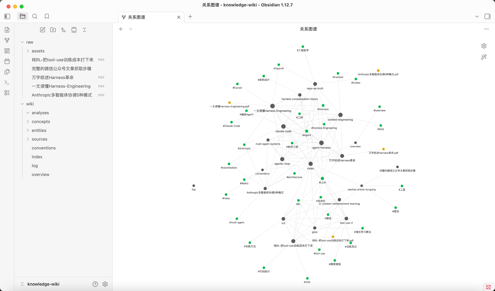
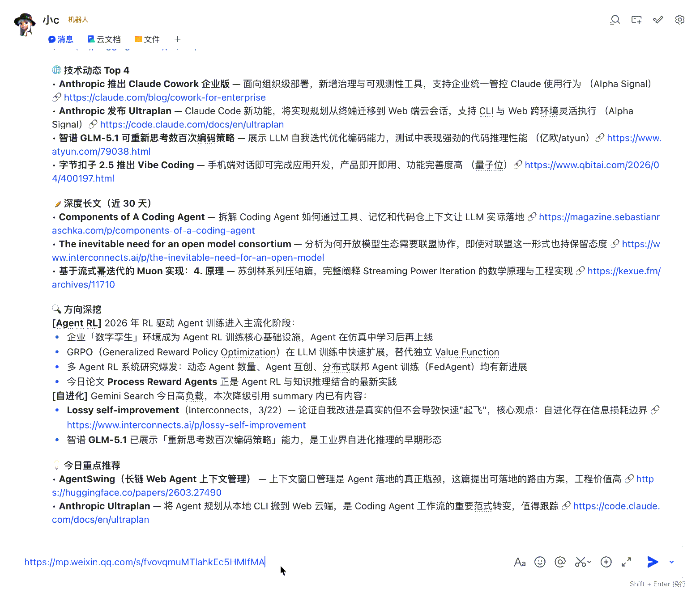

<div align="center">

<h1>🧠 Second Brain Skill</h1>

<p><strong>Créez votre second cerveau alimenté par l’IA</strong></p>

<p>
  Inspiré de <a href="https://gist.github.com/karpathy/442a6bf555914893e9891c11519de94f">LLM Wiki de Karpathy</a>.<br>
  Une base légère et extensible pour construire une base de connaissances qui évolue continuellement.
</p>

<p>
  <a href="https://github.com/ChavesLiu/second-brain-skill/stargazers"></a>
  <a href="https://github.com/ChavesLiu/second-brain-skill/network/members"></a>
  <a href="../../LICENSE"></a>
  
</p>

<p><a href="../../README.md">中文</a> | <a href="../../README.en.md">English</a> | <a href="README.ja.md">日本語</a> | <a href="README.es.md">Español</a> | <strong>Français</strong> | <a href="README.ko.md">한국어</a></p>

</div>

---

## Présentation

**Second Brain Skill** est une implémentation open source inspirée du concept [LLM Wiki](https://gist.github.com/karpathy/442a6bf555914893e9891c11519de94f) d’Andrej Karpathy. Elle transforme des informations personnelles dispersées en un wiki structuré, interconnecté et évolutif.

Le projet fournit une **base minimale, fonctionnelle et extensible**, facile à forker, personnaliser et enrichir pour créer son propre second cerveau.

### De la recherche à l’accumulation des connaissances

**Le RAG traditionnel fonctionne comme un interpréteur ; Second Brain Skill adopte une approche inspirée du compilateur.** Là où le RAG récupère surtout des informations au moment de la requête, les LLM transforment progressivement les documents en wiki structuré et entretiennent les liens entre sources, entités et concepts.

**Le RAG retrouve les connaissances. Le LLM Wiki les construit.**

Vous choisissez les documents et posez de bonnes questions ; le LLM gère les résumés, les références croisées, l’archivage et la cohérence.

## Démonstration

Découvrez comment des documents deviennent une base de connaissances structurée et interconnectée.


## Architecture en trois couches

Les documents bruts, les connaissances structurées et les conventions de fonctionnement sont séparés.

| Couche | Emplacement | Rédacteur | Lecteur | Contenu |
| --- | --- | --- | --- | --- |
| **Documents bruts** | `raw/` | Vous | LLM | Articles, notes, PDF, images, publications |
| **Base de connaissances** | `wiki/` | LLM | Vous | Résumés, entités, concepts, analyses, liens |
| **Spécification** | `Skill` | Évolution commune | LLM | SCHEMA, workflows, scripts |

Les documents d’origine restent intacts, tandis que le wiki et ses conventions évoluent indépendamment.

## Démarrage rapide

### 1. Installation

Clonez le dépôt, copiez le Skill dans le répertoire global de Claude Code, puis installez ses dépendances Python :

```bash
git clone https://github.com/ChavesLiu/second-brain-skill.git
cp -r second-brain-skill/skills/wiki ~/.claude/skills/wiki
pip install -r ~/.claude/skills/wiki/scripts/requirements.txt
```

### 2. Initialiser une base de connaissances

```text
/wiki init
```

Suivez les instructions pour choisir le chemin, le nom et la langue du contenu que la wiki générera. L’initialisation propose actuellement `zh` (chinois) ou `en` (anglais) ; les traductions du README n’ajoutent pas de prise en charge d’autres langues pour le contenu généré.

### 3. Importer un premier document

Placez vos documents dans le répertoire `raw/` de la base de connaissances :

```bash
cp my-article.md ~/my-kb/raw/
```

```text
/wiki ingest
```

Le LLM lit le document, crée des résumés, extrait les entités et concepts et entretient les références croisées. Une importation peut créer ou mettre à jour 10 à 15 pages selon le contenu.

### 4. Interroger vos connaissances

```text
/wiki query Qu’est-ce que Memex ?
```

```text
Compare les avantages et les limites du RAG et de l’approche Wiki
```

Vous pouvez aussi poser vos questions en langage naturel. Le LLM relie les informations de la base pour répondre.

## Commandes principales

| Commande | Fonction |
| --- | --- |
| `/wiki help` | Afficher l’aide et la liste des commandes disponibles |
| `/wiki init` | Créer et enregistrer une base de connaissances |
| `/wiki ingest` | Importer des documents (Markdown, PDF, images) |
| `/wiki query <question>` | Répondre à partir de la base |
| `/wiki lint` | Vérifier la santé et la cohérence du wiki |
| `/wiki wipe` | Supprimer ou réinitialiser des pages wiki (récupérable via `wiki/.trash/`) |
| `/wiki test` | Exécuter les tests automatisés |

La suppression ou la réinitialisation du contenu déplace les pages vers `wiki/.trash/` ; `/wiki wipe restore` permet de les restaurer et `raw/` reste inchangé. `/wiki wipe empty-trash` vide définitivement la corbeille : ensuite, seul le contenu déjà enregistré dans l’historique Git peut être récupéré via Git.

Toutes les commandes sont également accessibles en langage naturel : nul besoin de les mémoriser.

## Mode langage naturel

Le Skill détecte votre intention et lance le workflow correspondant.

| Votre demande | Action |
| --- | --- |
| « Importe cet article » | Importer le document |
| « Qu’est-ce que Memex ? » | Interroger le wiki |
| « Compare RAG et Wiki » | Rechercher et synthétiser |
| « Cite toujours les sources » | Enregistrer la préférence dans `conventions.md` |
| « Vérifie la base » | Contrôler son état |

Cette approche fonctionne aussi avec des interfaces conversationnelles comme OpenClaw, à condition que l’environnement ait accès au Skill, à la base de connaissances et aux outils nécessaires.

## Intégration Obsidian

Ouvrez directement la base Markdown dans [Obsidian](https://obsidian.md/) pour explorer graphes, liens entrants et pages.



Extensions recommandées :

- **Front Matter Title** — Affiche les titres sur les nœuds du graphe (préconfiguré)
- **Dataview** — Interroge les métadonnées frontmatter
- **Web Clipper** — Enregistre des articles dans `raw/`

## OpenClaw (Web)

Second Brain Skill peut aussi s’intégrer à OpenClaw pour gérer les connaissances par conversation, mais il ne fonctionne pas « prêt à l’emploi » simplement en ouvrant OpenClaw. Il faut installer le Skill dans l’environnement OpenClaw, synchroniser ou exposer la base de connaissances, puis enregistrer les chemins et règles d’usage dans sa mémoire.

Une fois cette mémoire configurée, OpenClaw peut reconnaître les documents envoyés par l’utilisateur, les enregistrer dans `raw/` et lancer l’importation. Pour les liens web, par exemple des articles WeChat, l’environnement doit aussi fournir des outils de téléchargement ou de navigateur (comme Playwright) afin que le LLM puisse ouvrir, sauvegarder puis importer le contenu.



Voir le [guide utilisateur — Intégration OpenClaw](../user-guide.en.md#openclaw-integration) pour les étapes détaillées.

## Arborescence de la base de connaissances

La base de connaissances conserve la structure suivante :

```text
~/my-kb/
├── raw/
│   ├── assets/
│   └── *.md / *.pdf
└── wiki/
    ├── index.md
    ├── log.md
    ├── overview.md
    ├── conventions.md
    ├── sources/
    ├── entities/
    ├── concepts/
    └── analyses/
```

| Chemin | Description |
| --- | --- |
| `raw/` | Documents d’origine : vous les écrivez, le LLM les lit seulement |
| `raw/assets/` | Images et pièces jointes |
| `wiki/` | Base de connaissances générée et maintenue par le LLM |
| `wiki/index.md` | Index du contenu |
| `wiki/log.md` | Journal des opérations |
| `wiki/overview.md` | Page de synthèse |
| `wiki/conventions.md` | Conventions d’utilisation et préférences |
| `wiki/sources/` | Pages de résumé des documents |
| `wiki/entities/` | Entités, comme personnes, organisations et outils |
| `wiki/concepts/` | Concepts, comme théories, méthodes et modèles |
| `wiki/analyses/` | Analyses, comparaisons et synthèses |

## Cas d’utilisation

- **Recherche** — Importer des publications et construire un réseau de connaissances
- **Lecture** — Traiter les livres chapitre par chapitre et relier personnages et thèmes
- **Développement personnel** — Organiser journaux, articles et notes de podcasts
- **Veille concurrentielle** — Suivre les concurrents et maintenir des comparatifs
- **Connaissances d’équipe** — Organiser comptes rendus et documents de projet

## Forkez et créez votre version

Second Brain Skill est un **point de départ, pas un produit fini**. Adaptez sa structure, ses workflows et ses conventions à votre recherche, à un domaine métier ou à votre équipe. **Forkez. Personnalisez. Construisez votre second cerveau.** Retours et contributions sont les bienvenus !

## Documentation

- **[Guide utilisateur](../user-guide.en.md)** — Installation, fonctionnalités, Obsidian et OpenClaw (en anglais)
- **[Philosophie de conception](../../skills/wiki/IDEA.md)** — Principes inspirés du LLM Wiki (en chinois)
- **[Documentation technique du Skill](../../skills/wiki/README.en.md)** — Spécifications, workflows et structure (en anglais)

## Remerciements

- [Andrej Karpathy](https://gist.github.com/karpathy/442a6bf555914893e9891c11519de94f) — Pour le concept LLM Wiki à l’origine de ce projet.

- [Vannevar Bush](https://en.wikipedia.org/wiki/Vannevar_Bush) — Pour avoir proposé Memex en 1945, précurseur de la gestion associative des connaissances.

## Historique des étoiles

[](https://www.star-history.com/?repos=chavesliu%2Fsecond-brain-skill&type=date&legend=top-left)

## Licence

Ce projet est distribué sous [licence MIT](../../LICENSE).
